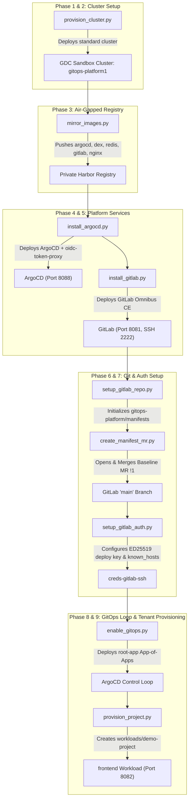

# Walkthrough: End-to-End GitOps Workshop Automated Execution on GDC Sandbox

Successfully executed and verified the complete end-to-end GitOps workshop automation from scratch against the Google Distributed Cloud (GDC) Sandbox environment, using the VS Code terminal bridge for all script invocations.

---

## 🚀 Execution Pipeline Summary



---

## 📋 Itemized Phase Execution & Verification

| Phase | Script Command | Key Actions | Status |
|---|---|---|---|
| **Phase 2: Cluster** | `provision_cluster.py -e .env.gdc -y` | Provisioned standard cluster `gitops-platform1` (3 control plane, 1 worker node) with `standard-rwo` CSI storage. | **Success** |
| **Phase 3: Mirror Images** | `mirror_images.py -e .env.gdc -y` | Pulled/tagged and pushed 6 workshop images (`argocd:v3.5.1`, `dex:v2.45.0`, `redis:8.2.3-alpine`, `python:3.11-alpine`, `gitlab-ce:latest`, `nginx:1.27-alpine`) to internal Harbor registry. | **Success** |
| **Phase 4: ArgoCD** | `install_argocd.py -e .env.gdc -y` | Deployed `oidc-token-proxy` for loopback GDC auth; deployed ArgoCD components with GDC overlays and image pull secrets. | **Success** |
| **Phase 5: GitLab Omnibus** | `install_gitlab.py -e .env.gdc -y` | Deployed single-pod GitLab Omnibus CE with 30Gi PVC; seeded root PAT (`admin-bootstrap-token`). | **Success** |
| **Phase 6A: GitLab Repo** | `setup_gitlab_repo.py -e .env.gdc -y` | Created group `gitops-platform`, project `manifests`, admin user `platform-admin`, and initialized default `main` branch. | **Success** |
| **Phase 6B: Seed Manifests** | `create_manifest_mr.py -e .env.gdc -y` | Committed all declarative Kubernetes manifests and opened/merged Merge Request !1 into `main`. | **Success** |
| **Phase 7: GitOps Auth** | `setup_gitlab_auth.py -e .env.gdc -y` | Created `argocd-readonly` service user with Reporter role; registered ED25519 deploy key in `creds-gitlab-ssh`; registered GitLab SSH host key in `argocd-ssh-known-hosts-cm`; verified end-to-end `git ls-remote` probe from `argocd-repo-server`. | **Success** |
| **Phase 8: Enable GitOps** | `enable_gitops.py -e .env.gdc -y` | Applied `project.yaml` (`AppProject`) and `root-app.yaml`. Established root App-of-Apps control loop. | **Success** |
| **Phase 9: Tenant Provision** | `provision_project.py -g workloads -p demo-project -a frontend -e .env.gdc -y` | Created `workloads` group and `demo-project` repo; seeded nginx workload manifests; merged platform integration MR !3 into `manifests`. | **Success** |

---

## 🔍 Validation Results

### 1. ArgoCD GitOps Application Hierarchy
All applications in the App-of-Apps tree are in `Synced` and `Healthy` status:

```text
NAME                SYNC STATUS   HEALTH STATUS
root-app            Synced        Healthy
argocd              Synced        Healthy
gitlab              Synced        Healthy
demo-project-apps   Synced        Healthy
frontend            Synced        Healthy
```

### 2. Tenant Workload Deployment
- Pod: `frontend-6bd84df5f9-ghp4r` in namespace `frontend` is `1/1 Running`.
- Service: `frontend` ClusterIP `10.252.21.131` on port 80.
- Live HTTP Probe:
  ```bash
  $ curl -I http://localhost:8082
  HTTP/1.1 200 OK
  Server: nginx/1.31.3
  Content-Type: text/html
  Content-Length: 896
  ```

### 3. Active UI & Service Endpoints

| Service | Local Endpoint | Credentials / Access | HTTP Code |
|---|---|---|---|
| **ArgoCD Web UI** | `https://localhost:8088` | GDC Fake OIDC Provider / admin | `200 OK` |
| **GitLab Web UI** | `http://localhost:8081` | User: `root` or `platform-admin@example.com` | `302 Found` (redirect to login) |
| **GitLab SSH** | `localhost:2222` | Dedicated ED25519 deploy key (`creds-gitlab-ssh`) | `Verified` |
| **Frontend Workload** | `http://localhost:8082` | Public Nginx service | `200 OK` |
